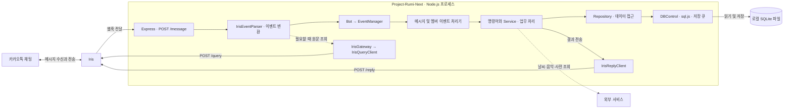
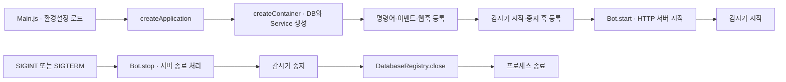
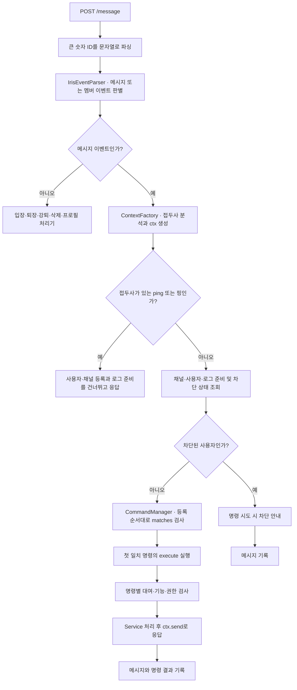
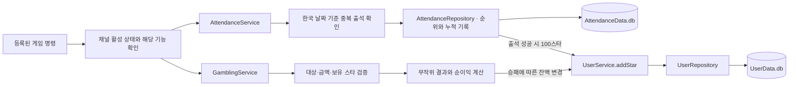
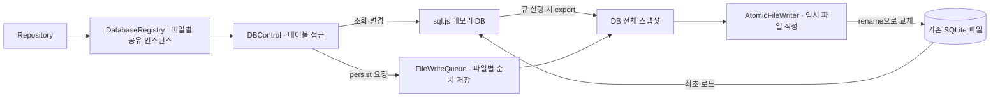
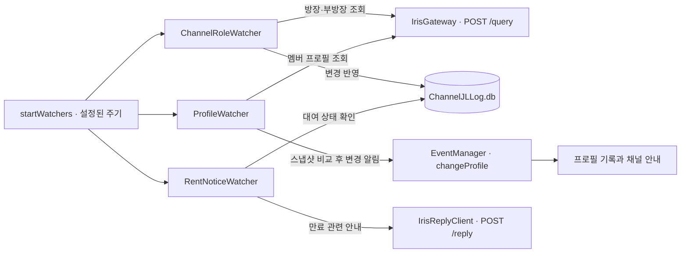

# Project-Rumi-Next 메커니즘 구조도

현재 실행 코드 기준입니다. GitHub 또는 Mermaid를 지원하는 Markdown 미리보기에서 구조도를 볼 수 있습니다. 박스는 역할별 모듈이며, Next 내부 모듈들은 하나의 Node.js 프로세스에서 실행됩니다.

## 1. 전체 구성

Iris의 메시지·멤버 DB는 `/query`로 조회합니다. 사용자 스타와 출석 기록을 저장하는 Next의 로컬 SQLite DB와는 별개입니다. 현재 등록된 계정·채널·게임·도구·대화 명령은 모두 같은 처리 경로를 사용합니다.

## 2. 시작과 종료

`createContainer`는 공유 Repository와 클라이언트를 구성하고, `ContextFactory`는 메시지마다 사용자·채널에 맞는 서비스를 묶습니다. 서버 종료 시 진행 중 요청을 기다리되 제한 시간을 넘긴 연결은 닫고, 감시기와 DB를 정리합니다.

## 3. 메시지 하나가 처리되는 순서

등록 순서는 `registerCommands.js`에 있습니다. 첫 일치 명령만 실행하며, 일반 대화 명령은 마지막에 검사합니다. 대여·기능 검사는 명령별로 수행하므로 모든 명령이 동일한 정책을 적용하는 것은 아닙니다.

잘못된 웹훅은 HTTP 400, 처리할 이벤트가 없는 정상 입력은 200으로 끝납니다. 명령 실행 오류는 채팅 안내와 로그로 처리하고, 상위로 전파된 오류는 HTTP 오류 처리기를 거칩니다. 그림은 정상 처리의 주요 경로를 나타냅니다.

## 4. 출석 체크와 도박

출석은 채널별로 당일 사용자 목록, 개인별 누적 횟수·당일 순위·1등 횟수를 저장합니다. 목록 및 내 출석 조회는 보상을 지급하지 않습니다.

흑백 도박은 승리 시 베팅액의 1배, 숫자 도박은 3배가 순이익입니다. 패배 시 베팅액을 잃습니다. 기존 `도박 100` 간편 명령은 45% 승률이며 순이익은 베팅액과 같습니다. 도박 전용 DB는 없고 결과 잔액을 사용자 DB에 저장합니다.

## 5. DB 저장 메커니즘

같은 파일의 여러 테이블은 하나의 메모리 DB를 공유합니다. 쓰기 큐는 파일 저장 순서를 제어하며, 출석 기록과 스타 지급처럼 여러 동작을 하나의 트랜잭션으로 묶는 장치는 아닙니다. 현재 구조는 단일 프로세스 운영을 전제로 합니다.

| 저장소 | 역할 |
|---|---|
| `data/users/UserData.db` | 계정·스타·권한·인벤토리 |
| `data/users/UserJLLog.db` | 메시지·명령·닉네임·멤버 기록 |
| `data/channels/ChannelJLLog.db` | 채널·대여·기능·방장·부방장 |
| `data/users/games/AttendanceData.db` | 출석 목록과 개인 통계 |
| `data/users/games/BeraData.db` | 베라31 승패 |
| `data/games/StockData.db` | 가상 주식 가격 |
| `data/db/Message.db` | 호출어 대화 데이터 |
| `data/db/MagicAnswer.json` | 마법의 답변 목록, SQLite가 아닌 JSON |

## 6. 주기 작업

감시기는 채팅 명령이 없어도 실행됩니다. 각 감시기의 실행 중 표시로 같은 작업의 중첩을 막고, 봇 종료 시 타이머를 해제합니다.

## 코드 찾아보기

- 시작 및 조립: [Main.js](../src/Main.js), [createApplication.js](../src/bootstrap/createApplication.js), [createContainer.js](../src/bootstrap/createContainer.js)
- 웹훅 및 메시지: [irisWebhookRoute.js](../src/http/routes/irisWebhookRoute.js), [ContextFactory.js](../src/core/ContextFactory.js), [message.js](../src/events/message.js)
- 명령 등록: [registerCommands.js](../src/bootstrap/registerCommands.js)
- DB 및 감시기: [DatabaseRegistry.js](../src/database/DatabaseRegistry.js), [startWatchers.js](../src/bootstrap/startWatchers.js)
- 전체 파일 설명: [Project-Structure.md](Project-Structure.md)
